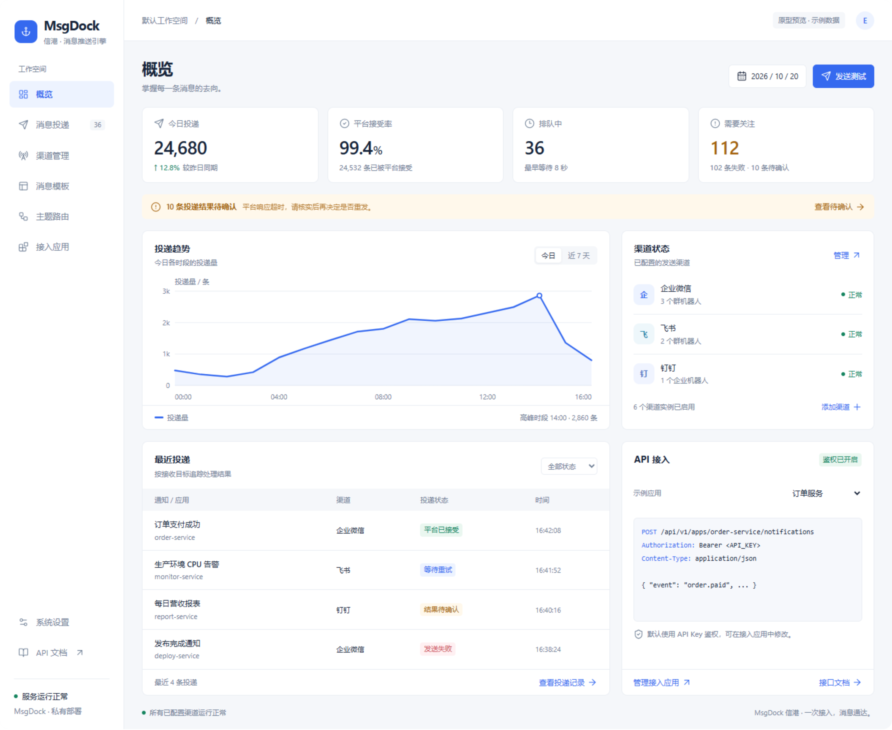

# MsgDock 控制台首页原型

版本：v0.1；日期：2026-10-20。原型展示登录后的管理控制台；所有指标、渠道实例与投递记录均为示例，不代表已上线的服务或已实现的能力。

## 页面组织

| 区域 | 内容与用途 |
| --- | --- |
| 侧栏 | 概览、消息投递、渠道管理、消息模板、主题路由、接入应用、系统设置和 API 文档 |
| 顶部 | 工作空间、当前页面和示例数据标识 |
| 核心指标 | 今日投递、平台接受率、排队数量和需要关注的数量 |
| 待办提示 | 将结果待确认的投递单独提示，便于核实后再决定是否重发 |
| 投递趋势 | 按小时或近七日查看投递量 |
| 渠道状态 | 企业微信、飞书、钉钉的已配置实例；提供渠道管理和添加入口 |
| 最近投递 | 按目标查看渠道、状态和时间，支持状态筛选 |
| API 接入 | 展示当前应用的路径、Bearer 请求头和鉴权状态；提供应用管理与文档入口 |

## 鉴权状态

新建应用默认使用 API Key；通过 HTTP 请求头 `Authorization: Bearer <API_KEY>` 传递。只有管理员显式将应用发送模式设为 none，才允许不带 Key 调用该应用的发送入口。管理后台与结果查询始终需要认证。

首页通过选择示例应用展示“鉴权已开启”和“非鉴权模式”两种状态；选择示例应用不会修改任何真实配置。真实 Key 不出现在首页、HTML 源码或前端构建产物中。

## 交互与状态约定

- “发送测试”打开目标渠道和消息内容弹窗；原型的“模拟发送”只展示受理反馈，不调用平台。
- “今日 / 近 7 天”切换趋势示例；最近投递支持状态筛选，“查看待确认”直接筛选 unknown。
- “平台已接受”只表示平台明确接受请求，不能据此显示用户已收到或已读。
- 结果待确认、失败和等待重试分别展示；不为 unknown 提供无条件一键重试。
- 尚未配置渠道时，实际页面应显示添加渠道的空状态；尚无投递时不展示模拟指标或伪造趋势。
- 首屏以桌面管理场景为主；窄屏采用单列面板与收起的导航，表格优先保留通知、状态和时间。

原型的可点击预览用于设计评审；本目录的图片是对应版本的静态基线。实现采用 React + Ant Design，组件与接口按[系统设计文档](../system-design.md)组织。
