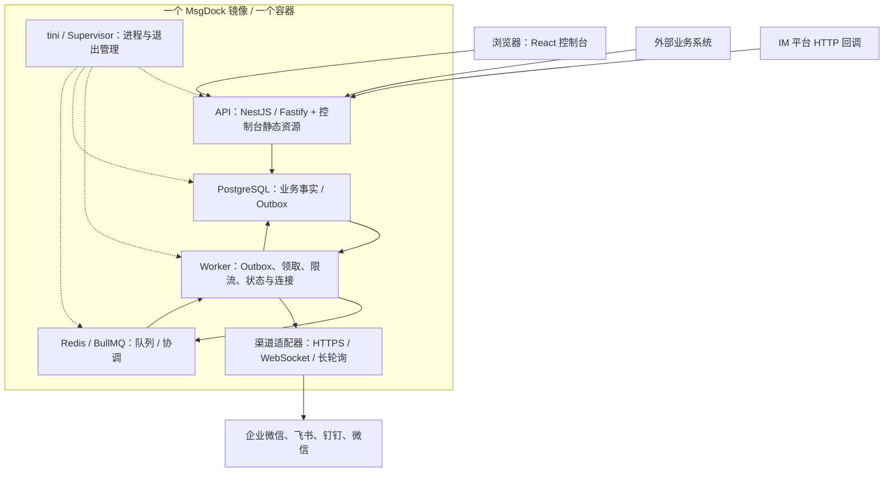
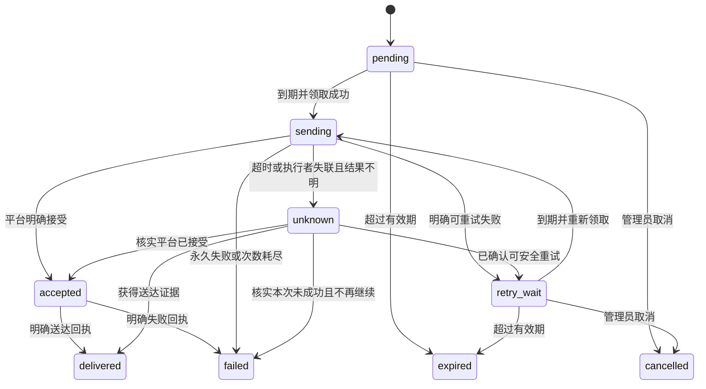

# MsgDock（信港）系统设计文档

| 项目 | 内容 |
| --- | --- |
| 文档版本 | v0.2 |
| 更新日期 | 2026-10-20 |
| 状态 | 首版设计基线，待实现与验证 |
| 仓库 | [mynameyi/msgdock](https://github.com/mynameyi/msgdock) |
| 项目许可证 | AGPL-3.0-only |
| 定位 | 面向多个 Web 业务系统复用、支持私有化部署的多渠道 IM 通知服务 |

本文确定首版的技术栈、前后端代码组织、模块边界、消息可靠性和部署方式。目录、接口、状态和默认参数是实现约定；本文不代表这些功能已经完成，也不包含实测容量承诺。

阅读导航：[技术栈](#3-技术栈) · [仓库与包依赖](#5-monorepo-与包依赖) · [前端组织](#6-前端代码组织) · [后端组织](#7-后端代码组织) · [渠道设计](#8-渠道与消息内容设计) · [可靠投递](#10-通知受理与可靠投递) · [API](#11-api-与协议契约) · [实施顺序](#15-实施顺序与评审边界)。

## 1. 核心设计决策

| 维度 | 采用的方案 | 选择依据 |
| --- | --- | --- |
| 仓库组织 | pnpm Workspace Monorepo | 控制台、API、Worker 和共享包协同开发，依赖边界明确 |
| 前端组织 | Feature-based：按业务功能聚合代码 | 与 React 组件、Hooks、路由和服务端状态管理的使用方式吻合 |
| 前端交互 | 组件化、单向数据流、按需提取业务 Hooks | 页面状态与展示有明确职责，保留简单页面的直接实现 |
| 后端组织 | NestJS Feature Modules，模块内部按职责分层 | 使用 NestJS 原生模块与依赖注入机制，按业务能力封装服务 |
| 后端形态 | 模块化单体，共享业务模块，API 与 Worker 为独立进程 | 默认在同一个容器运行；保留以后拆分进程部署的能力 |
| 核心建模 | 为通知、投递、发送尝试定义明确模型与状态规则 | 核心复杂度在可靠投递、平台差异和失败恢复 |
| 渠道扩展 | 稳定的渠道接口与进程内适配器注册 | 新平台接入时复用调度、审计和状态处理 |
| 数据权威 | PostgreSQL 保存业务事实；Redis 承载队列与协调状态 | 队列丢失后可以依据数据库检查和重建未执行任务 |
| 受理一致性 | 消息、投递计划与 Outbox 在同一事务提交 | 消除数据库提交与队列入队之间的直接双写空隙 |
| 执行语义 | 按至少一次执行设计，使用幂等、租约与结果核查控制重复 | 第三方接口并不统一提供端到端幂等和可查询回执 |
| 渲染与部署 | React SPA；Fastify 同域提供静态资源和 API | 前后端代码分离，发布时合并进一个镜像 |
| 部署单元 | 单个 Docker 镜像、单个容器，内含 API、Worker、PostgreSQL 与 Redis | 默认不要求另行部署数据库、Redis 或 Nginx |
| 推送接口鉴权 | 每个应用可选 api_key 或 none，默认 api_key | API Key 通过 HTTP 请求头 Authorization: Bearer 传递；关闭鉴权仅作用于指定应用的发送接口 |

前端和后端分别确定代码组织方式。MVC、MVVM、DDD 与 Feature-based 解决的问题并不相同，本项目不以其中一个名称概括全部实现：前端采用 React 常见的组件与状态组织方式，后端采用 NestJS 业务模块和分层服务。领域建模重点用于投递规则，普通配置功能采用直接的增删改查实现。

## 2. 目标、场景与首版范围

### 2.1 主要使用场景

- 多个业务系统通过统一 API 发送告警、订单提醒、审批通知、任务结果与日报。
- 管理员集中配置渠道实例、接收目标、主题路由和消息模板。
- 相同业务通知可以投递到多个 IM 渠道，分别查询每个目标的处理结果。
- 运维人员能够定位失败原因、查看发送尝试，并在确认重复风险后发起人工重发。

### 2.2 首版交付范围

- 一个部署实例对应一个工作空间，支持多个接入应用、多个管理员与角色。
- 应用 API Key、默认开启的发送鉴权、显式可选的非鉴权发送、管理端登录、资源授权和操作审计。
- 渠道实例、目标、主题、路由规则、模板版本与发送测试。
- 企业微信群 Webhook、飞书群 Webhook、钉钉企业机器人主动发送。
- 通知受理、持久化投递、模板渲染、目标级状态、限流、过期、明确失败后的重试。
- 投递日志、未知结果标记、人工重发与基础运行指标。
- 单镜像单容器部署、持久化目录、数据库迁移、备份与恢复说明。

### 2.3 后续扩展边界

企业微信智能机器人、飞书应用机器人、钉钉 Stream、微信相关开放接口依次增加。交互卡片回调、用户身份绑定、媒体消息、业务结果 Webhook 和 SaaS 多租户作为后续能力实现。

首版的工作空间字段用于资源归属与隔离；提供多租户 SaaS 前，还需要完成跨工作空间权限、数据、队列配额及运维隔离的专项验证。平台用户的海量终端连接由对应 IM 平台维护，MsgDock 管理应用、机器人和平台接口的连接。

## 3. 技术栈

| 层面 | 技术选择 | 具体用途 |
| --- | --- | --- |
| 语言 | TypeScript，启用 strict | 前后端、任务处理与适配器开发 |
| 运行时 | Node.js 24 LTS | 使用受支持分支的最新安全补丁 |
| 前端 | React 19、Vite、React Router | 页面、开发构建、路由与按路由懒加载 |
| UI | Ant Design | 表单、表格、布局、提示、弹窗 |
| 前端服务端状态 | TanStack Query | 请求缓存、加载与错误状态、Mutation 后刷新 |
| 前端本地状态 | useState、useReducer；少量 Context | 交互状态、复杂局部状态与会话上下文 |
| 后端 | NestJS、FastifyAdapter | HTTP API、模块组织、注入与启动装配 |
| 请求校验 | class-validator、class-transformer | DTO 的运行时校验与受控转换 |
| 接口描述 | @nestjs/swagger、OpenAPI | 生成接口契约与文档 |
| 前端 API 客户端 | openapi-typescript、openapi-fetch | 根据公开 OpenAPI 生成类型并调用接口 |
| 数据库 | PostgreSQL 18 | 配置、模板、通知、投递、Outbox、审计 |
| 数据访问 | Prisma、Prisma Migrate | 查询、事务与版本化迁移；特殊领取查询使用受控参数化 SQL |
| 队列 | Redis、BullMQ、@nestjs/bullmq | 后台任务、延迟执行、并发与队列状态 |
| 模板 | Mustache 变量模板、渠道结构化渲染器 | 受限文本插值与不同平台格式转换 |
| 日志 | Pino、nestjs-pino | 结构化日志、关联标识、敏感字段脱敏 |
| 测试 | 后端 Jest、前端 Vitest 与 Testing Library、Playwright | 业务规则、真实组件交互、集成与关键端到端流程 |
| 工程 | pnpm Workspace、ESLint、Prettier | 依赖管理、边界检查与一致格式 |
| 静态资源 | @fastify/static，兼容当前 NestJS / Fastify 版本 | 提供控制台构建产物与受控的 SPA 路由回退 |
| 发布 | GitHub Actions、Docker 多阶段构建、tini、Supervisor | 一个最终镜像；管理 API、Worker 与内置数据服务进程 |
| 文件 | 挂载目录起步，封装存储接口 | 后续按需接入 S3 兼容对象存储 |

初始化工程时，选择与 Node.js 24 兼容的稳定依赖组合，提交 pnpm-lock.yaml，固定运行时和容器镜像版本。具体小版本由初始化结果记录，不以浮动 latest 作为发布基线。Node.js 与 PostgreSQL 的版本状态见参考资料 [R1]、[R2]。

## 4. 系统结构与职责



| 部分 | 职责 |
| --- | --- |
| 控制台 | 配置管理、发送测试、投递查询、权限范围内的操作 |
| API 进程 | 身份认证、授权、校验、幂等受理、配置与查询、HTTP 回调入口 |
| Worker 进程 | Outbox 扫描与入队、任务消费、重试调度、对账、连接维护 |
| PostgreSQL | 可追溯的业务状态、发送计划、执行证据与恢复依据 |
| Redis | BullMQ 数据、原子限流、短期连接路由与协调；队列开启持久化 |
| 渠道适配器 | 平台鉴权、格式校验、渲染、发送、平台结果归一化 |
| 进程管理 | 启动依赖、监督退出、转发信号与回收子进程；不承担业务调度 |

前后端代码分离，部署时使用同一个域名。根路径提供控制台，`/api/v1/` 提供业务 API，`/api/admin/` 提供管理接口，`/webhooks/im/` 提供平台 HTTP 回调。前端路由回退规则只处理页面路径，API 与回调错误保留其原始 HTTP 状态。

控制台首版采用按需刷新与有界轮询。后续出现实时状态需求时增加 SSE。机器人 WebSocket 与长轮询由 Worker 管理，与浏览器页面生命周期分开。

## 5. Monorepo 与包依赖

```text
msgdock/
├── apps/
│   ├── console/                 # React 管理控制台
│   ├── api/                     # HTTP 入口、Controller、DTO、API 装配
│   └── worker/                  # 队列消费者、调度器、连接运行时装配
├── packages/
│   ├── server/                  # API / Worker 共用的 NestJS 业务模块
│   ├── channels/                # 各平台适配器及注册工厂
│   ├── contracts/               # 后端包间稳定类型、渠道与任务接口
│   ├── database/                # Prisma schema、迁移、数据库客户端
│   ├── api-client/              # 从公开 OpenAPI 生成的前端客户端与类型
│   └── tooling/                 # 共享 TypeScript、ESLint 等工程配置
├── docs/
│   └── system-design.md
└── deploy/                      # Dockerfile、入口脚本、Supervisor、内置数据服务配置
```

依赖约定：

1. `console` 依赖 `api-client` 与自身前端代码，不导入 `server`、Prisma 或平台 SDK。
2. `api` 与 `worker` 都依赖 `server` 的公开模块，不互相导入对方的应用目录。
3. `server` 可以使用 `database`、`channels`、`contracts`；`channels` 使用 `contracts` 和平台 SDK，不反向导入 `server`。
4. `contracts` 保持纯 TypeScript，描述跨包边界；HTTP 契约以服务端 DTO 生成的 OpenAPI 为准，客户端不另维护一套重复接口定义。
5. 依赖通过 package.json、受限 exports 和 ESLint 规则显式声明，CI 检查循环依赖与跨边界导入。

共享包基于真实调用关系拆分。业务规则保留在所属业务模块，通用包不接收无法归属的业务逻辑。

## 6. 前端代码组织

### 6.1 选择：Feature-based 与组件化

按业务功能组织页面、组件、请求、状态和类型；组件使用 React 单向数据流，业务 Hooks 提取确实需要复用或隔离的逻辑。这是本项目对 React 常见实践的具体应用，不将自定义 Hook 等同于必须存在的 ViewModel。依据见 [R3]、[R4]。

```text
apps/console/src/
├── app/
│   ├── router.tsx              # 路由表、懒加载、页面组合
│   ├── providers.tsx           # QueryClient、主题、会话等 Provider
│   └── layouts/                # 应用布局
├── features/
│   ├── channels/
│   │   ├── pages/              # 渠道列表、详情、编辑
│   │   ├── components/         # 渠道配置表单、连接状态等
│   │   ├── hooks/              # useChannels、useTestChannel 等
│   │   ├── api.ts              # 调用生成的客户端
│   │   ├── queries.ts          # Query Key、Query Options、Mutation
│   │   ├── types.ts            # 页面专用类型；公开 DTO 取自 api-client
│   │   └── index.ts            # 对其他模块公开的入口
│   ├── applications/
│   ├── targets/
│   ├── templates/
│   ├── notifications/
│   ├── deliveries/
│   └── identity/
└── shared/
    ├── ui/                     # 跨业务通用组件
    ├── api/                    # 客户端配置、通用错误转换
    ├── hooks/                  # 通用 Hooks
    └── lib/                    # 与具体业务无关的工具
```

### 6.2 页面与逻辑职责

| 部分 | 责任 | 边界 |
| --- | --- | --- |
| Page | 组合组件、关联路由参数、调用本功能 Hooks | 保持请求编排和复杂转换可提取 |
| Component | 展示与本地交互，使用 Ant Design 组件 | 可复用展示组件通过 props 与事件协作 |
| Hook / queries | 查询与 Mutation、状态组合、用户操作编排 | 根据业务动作命名，避免只有生命周期名称的万能 Hook |
| api.ts | HTTP 请求、参数和结果的必要转换 | 不持有页面状态，也不引入 UI 组件 |
| shared | 多个模块共用的基础能力 | 不反向依赖具体 feature |

简单页面可以直接使用 Query Hooks；只有状态或交互复杂时才增加独立业务 Hook。组件、请求和状态处理的单元测试靠近被测代码放置。

### 6.3 状态管理规则

- 服务端数据由 TanStack Query 管理，Mutation 成功后精确失效相关 Query Key。
- Query Key 包含工作空间及必要资源范围；退出登录或切换范围时清理相关缓存。
- 输入框、弹窗等局部状态使用 useState，存在复杂状态转换时使用 useReducer。
- 可分享的筛选、分页和排序放到 URL 参数中，刷新后保持相同查询视图。
- 会话身份、主题等少量全局信息通过 Context 提供；跨页面复杂客户端状态出现后，再按实际需求引入专用状态库。
- 凭证详情在后端脱敏，前端只接收展示与操作所需字段；按钮可见性与路由守卫用于交互体验，后端仍独立授权。

跨 feature 使用公开入口。包含多个业务功能的页面由 app 路由层组合，避免 feature 之间形成循环依赖。Feature-based 本身不要求引入 Redux，也不要求采用完整 FSD 分层。

## 7. 后端代码组织

### 7.1 选择：NestJS Feature Modules 与模块内分层

业务模块按能力封装，入口适配器按运行进程放置。NestJS 官方模块机制支持通过 exports 暴露受控能力，API 与 Worker 共用同一套业务实现，依据见 [R5]。

```text
apps/api/src/
├── main.ts
├── app.module.ts
└── http/
    └── channels/
        ├── channels-http.module.ts
        ├── channels.controller.ts
        └── dto/

packages/server/src/modules/
└── channels/
    ├── channels.module.ts       # 业务 Provider 与依赖装配
    ├── channels.service.ts      # 配置、测试等用例
    ├── channels.repository.ts   # 本模块数据访问
    ├── models/                 # 内部模型
    ├── policies/               # 可独立测试的规则
    └── index.ts                # 模块对外能力

apps/worker/src/
├── main.ts
├── worker.module.ts
├── processors/                 # 任务消费入口
├── dispatchers/                # Outbox 与延迟调度
└── connections/                # 长连接归属与运行时
```

### 7.2 业务模块与数据所有权

| 模块 | 主要职责 |
| --- | --- |
| identity | 管理员、角色、会话、管理端授权 |
| applications | 接入应用、auth_mode（默认 api_key）、API Key、可访问主题与目标范围 |
| channels | 渠道实例、加密凭证、能力声明、健康状态 |
| routing | 注册目标、主题、路由规则、投递目标解析与去重 |
| templates | 模板、版本、变量定义、预览和渲染规则 |
| notifications | 通知受理、幂等、投递计划和快照 |
| deliveries | 投递领取、状态机、尝试记录、重试、人工重发 |
| outbox | 业务事务内事件记录、发布租约、待执行任务补偿 |
| audit | 操作审计、敏感配置变更记录 |

模块通过公开服务接口协作；各模块的数据写入由自己的服务与仓储负责。跨模块事务由应用用例协调，受控传递事务上下文，保证通知、投递与 Outbox 原子提交。Prisma 对象与平台 SDK 类型不穿入 HTTP DTO 或前端契约。

### 7.3 各层职责

- **Controller / Processor**：完成协议转换、调用授权入口、校验输入，调用业务用例并转换结果。
- **Service / Use Case**：编排业务操作，确定事务边界，调用规则、仓储和渠道能力。
- **Model / Policy**：描述投递状态、过期判断、可重试条件等业务规则，使用普通 TypeScript。
- **Repository**：执行本模块的数据访问，暴露业务需要的查询和更新，关键状态更新带条件或版本校验。
- **Adapter**：处理外部平台、存储或队列的技术差异。

普通配置模块采用 Controller、Service、Repository 即可。通知与投递模块在状态规则复杂处增加 policies、models 或独立用例文件。首版使用领域建模表达核心规则，不要求每个模块建立完整 DDD 战术模型，也不为所有类增加只有一个实现的接口。

### 7.4 依赖与扩展约束

Controller 不直接调用 Prisma 或平台 SDK；队列 Processor 与 HTTP Controller 调用相同业务服务。跨模块调用经过模块公开 API，不读取其他模块内部文件。接口只抽象在平台、存储和执行边界等有替换或测试价值的位置。

使用 NestJS 显式 Provider Token 注入渠道注册表与关键外部能力。生产运行不允许上传并动态执行第三方插件；新增适配器通过代码评审、测试和随版本发布接入。

## 8. 渠道与消息内容设计

### 8.1 平台、类型、实例与目标

- **平台**：企业微信、飞书、钉钉、微信。
- **渠道类型**：例如 wecom.group_webhook、wecom.aibot、feishu.app、dingtalk.enterprise_bot。
- **渠道实例**：一个具体机器人或企业应用的配置与凭证。
- **目标**：注册的群、用户、部门或平台会话，绑定所属渠道实例及可发送范围。
- **主题**：业务使用的逻辑接收集合，例如 finance；路由到一个或多个已授权目标。

平台用户 ID、会话 ID、媒体 ID 均在对应企业、应用或渠道实例的命名空间内使用。不同应用中的同名用户 ID 不默认视为同一身份。

### 8.2 接入类型与计划

| 渠道 | 首要传输方式 | 阶段与注意点 |
| --- | --- | --- |
| 企业微信群机器人 | HTTPS Webhook | 首版；按具体群配置实例 |
| 飞书自定义群机器人 | HTTPS Webhook | 首版；用于所在群单向通知 |
| 钉钉企业机器人 | HTTPS OpenAPI 主动发送 | 首版；使用企业应用授权与目标范围 |
| 企业微信智能机器人 | 官方 SDK 的 WebSocket | 后续；独立管理连接与会话权限 |
| 飞书应用机器人 | HTTPS 发送，WebSocket 或 HTTP 接收事件 | 后续；按应用授权能力接入 |
| 钉钉 Stream | WebSocket 接收事件，消息发送按对应 OpenAPI | 后续；接收与发送分别适配 |
| 微信公众号 / 小程序 | 各自官方消息接口 | 后续；按模板、授权和具体业务场景实现 |
| 微信 ClawBot | HTTP 长轮询与 HTTP 发送接口 | 后续；验证会话上下文与实际开放范围 |

钉钉旧式自定义 Webhook 机器人仅在需要兼容已有实例时增加支持，接入前重新核对官方下线与迁移信息 [R11]。微信不同开放产品分别设计，群能力和主动触达范围通过实际授权及官方资料确认 [R12]。

### 8.3 适配器契约

下例表示职责，具体字段在工程初始化时形成类型定义：

```typescript
interface ChannelAdapter {
  readonly type: string;
  readonly capabilities: ChannelCapabilities;
  validate(config: ChannelConfig, message: MessageEnvelope): ValidationResult;
  render(message: MessageEnvelope, target: TargetSnapshot): RenderedMessage;
  send(context: SendContext, message: RenderedMessage): Promise<SendOutcome>;
}
```

能力声明覆盖主动发送、文本、Markdown、卡片、交互回调、媒体、目标类型、平台幂等与结果查询。长连接生命周期采用独立的 Connector 契约，由连接运行时负责启动、停止和健康检查。

SendOutcome 区分平台接受、明确可重试失败、永久失败与结果未知。平台 HTTP 200 内的业务错误仍需解析。结果包含平台消息 ID、错误分类、可选 retryAfter 和脱敏诊断信息。

### 8.4 模板、渲染与媒体

- 模板有不可变版本；受理时固定模板版本、变量、目标与路由快照。
- 通用消息表达标题、正文、字段、链接和可选操作；平台渲染器负责最终格式、长度、提及人与能力检查。
- Mustache 上下文仅接收经过校验的 JSON 数据，限制为受控变量替换，不提供函数型值或任意代码执行；原生卡片通过结构化字段赋值生成。
- 文本、Markdown 和卡片分别转义与校验；Mustache 默认 HTML 转义不作为所有 IM 格式的通用转义策略。
- 不支持的能力在受理或渲染阶段明确报错，或按已配置规则降级；需要交互回传的业务不能静默降级为无回传链接。
- 目标、模板版本与渲染输入在重试中保持一致；凭证使用当前有效密钥，渠道停用与权限撤回优先于历史快照。
- 媒体阶段通过受控文件引用接入，上传得到的平台媒体 ID 按渠道实例、内容摘要和有效期缓存，过期后重新上传。

### 8.5 长连接的归属

同一机器人实例由连接租约协调所属 Worker。租约在 PostgreSQL 保存 owner、到期时间与原子递增的 epoch，Redis 只缓存持有者路由；发送前校验归属，失租后停止发送并断开连接。投递 Worker 通过内部实例路由将任务交给连接持有者，避免其他 Worker 各自重复连接。

内部转交仍保留同一 Delivery ID，由持有者领取投递租约并写入 Attempt。回执关联 request ID、Delivery 和 Attempt。断线采用带随机抖动的退避重连，保存平台要求的游标与会话上下文。租约提供内部协调，外部平台是否支持单连接、幂等和主动发送仍由对应能力约束。

## 9. 核心数据模型

| 实体 | 主要内容与约束 |
| --- | --- |
| Workspace | 部署工作空间与资源归属 |
| User / Role / Session | 管理身份、权限、服务端会话与到期信息 |
| Application / ApiKey | 接入应用、密钥摘要、权限范围、撤销与轮换 |
| ChannelInstance | 渠道类型、非敏感配置、加密凭证、启停和健康状态 |
| ConnectionLease | 需要长连接的渠道实例、持有者、租约期限和递增 epoch；按渠道阶段启用 |
| Target / Topic / Route | 已注册目标、逻辑主题和路由关系；包含应用授权 |
| Template / TemplateVersion | 模板标识、不可变版本、变量定义与渲染内容 |
| Notification | 应用、事件、原始受理时间、期限、固定快照、关联标识 |
| Delivery | 目标和渠道、状态、期限、调度代次、下次执行时间、执行租约与可选 ordering_key |
| DeliveryAttempt | 每次真实发送的请求标识、起止时间、分类结果和平台消息 ID |
| IdempotencyRecord | 工作空间、应用、操作、幂等键、请求摘要、通知 ID、保留期限 |
| OutboxEvent | 待入队投递、调度代次、notBefore、发布状态和发布租约 |
| InboxEvent | 平台事件标识、验签结果、去重键与异步处理状态；按渠道阶段启用 |
| AuditLog | 操作者、动作、资源、时间与脱敏变更摘要 |

主要关系：一条 Notification 对应多条 Delivery，一条 Delivery 对应多条 DeliveryAttempt。应用、主题、目标、模板和渠道资源均带工作空间归属；接入请求的应用身份从凭证取得。

### 9.1 索引与约束

- 主键使用应用生成的 UUID，时间以 UTC timestamptz 保存，对外采用 ISO 8601。
- 幂等键唯一约束覆盖 workspace_id、application_id、operation、key。
- 同一通知的目标去重键覆盖 channel_instance_id、target_id 与消息分段序号。
- DeliveryAttempt 对 delivery_id、attempt_no 建立唯一约束。
- Outbox 对 delivery_id、schedule_generation、event_type 建立唯一约束。
- 平台事件对工作空间、渠道实例、平台事件 ID 建立唯一约束；无稳定事件 ID 时由适配器提供文档化去重策略。
- Delivery 为状态、next_attempt_at、expires_at 建立调度索引，为应用、创建时间和 ID 建立查询索引。
- JSONB 保存版本化配置和消息快照；权限、归属、状态、时间等检索字段采用明确列。

关联资源停用采用明确状态。删除策略保留投递所需快照和审计依据；不通过级联删除抹去发送历史。

## 10. 通知受理与可靠投递

### 10.1 通知受理事务

1. 从路径解析接入应用并读取其 auth_mode；按模式验证 API Key 或建立该应用的匿名发送上下文，检查应用权限、限额、请求大小和基本结构，规范化请求并计算摘要。
2. 按应用与操作范围查询幂等记录；命中时核对摘要并返回原通知或冲突结果。
3. 未命中时，在同一数据库事务内建立幂等记录，读取有效模板与授权路由，完成变量、目标去重和能力检查，创建 Notification、Delivery、固定快照与 OutboxEvent。
4. 幂等记录与通知在同一事务绑定；并发插入冲突时重新读取已提交记录并核对摘要，避免生成第二组投递计划。
5. 事务成功后返回 202 和 Notification ID；不在请求中调用 IM 发送接口。

幂等键对发送请求必填。同键同语义请求返回原通知；同键不同请求返回 409。请求摘要基于规范化的受理字段计算，忽略请求追踪等非语义元数据；相对 TTL 保留第一次受理产生的 expires_at，不因重复请求延长。

默认消息有效期为 1 小时，首版允许配置至最多 7 天；幂等记录默认保留 30 天，具体配额由管理员控制。保留期结束后的相同键可能作为新请求受理，接口文档必须公开这一语义。

### 10.2 Outbox 入队与补偿

- 分发器使用短事务、租约和 SKIP LOCKED 批量领取到期事件；网络入队操作在数据库领取事务之外执行。
- Job ID 由 Delivery ID 与调度代次组成，使用 BullMQ 允许的字符；队列 Payload 仅包含定位任务所需字段，不包含明文凭证。
- 入队成功后标记 Outbox 已发布；标记前崩溃允许重复发布，由稳定 Job ID 和数据库领取条件进一步去重。
- 定期扫描数据库中到期、尚未发送且没有有效执行租约的 Delivery，与队列状态核对并补投遗漏任务。
- Redis 数据丢失时，已发布标记不能单独证明任务仍存在；以 Delivery 的当前状态与调度代次恢复任务。
- Outbox 发布失败只重试入队，不执行平台发送；保留失败原因、下次发布时间和告警。

Redis 开启 AOF，并配置 maxmemory-policy=noeviction；队列不与可随意淘汰的缓存混用 [R7]。API 受理不依赖 Redis 在线，但达到配置的积压上限时停止新增受理并返回明确的过载响应。

### 10.3 投递状态

| 状态 | 含义 |
| --- | --- |
| pending | 计划已持久化，等待执行；不以 Redis 内是否存在 Job 定义业务状态 |
| sending | 当前执行者持有有效租约，正在执行发送 |
| retry_wait | 已确认允许重试，等待 next_attempt_at |
| accepted | 平台已明确接受请求；尚不代表用户收到或已读 |
| delivered | 具有平台明确送达证据；仅支持该能力的渠道使用 |
| failed | 永久错误、达到最大尝试次数，或明确失败回执 |
| expired | 尚未发送成功且超过有效期 |
| cancelled | 在允许取消的待执行状态下被取消 |
| unknown | 请求可能已经产生外部效果，但没有获得确定结果 |



Notification 的查询结果返回各 Delivery 的状态计数。全部目标均达到 accepted 或 delivered 才可显示“全部平台已接受”；部分失败显示“部分完成”，存在 unknown 时显式展示“结果待确认”。已读信息作为可选回执字段单独记录。

### 10.4 任务领取、租约与重试

- Worker 先读取并检查投递计划，完成发送前校验与渲染，再取得渠道配额；需要等待时延迟重排，不建立真实发送 Attempt。
- 获得配额后，用数据库条件更新再次检查状态、调度代次、期限和版本，领取租约并建立 Attempt；旧代次 Job、已完成任务与领取失败的重复任务直接结束。调用前再次检查期限、连接归属与有效授权。
- Attempt 区分准备、请求已开始和结果记录；发出平台请求前，先持久化 request_started_at 并确认租约有效，再调用发送接口。进入请求阶段才增加发送尝试次数；配额等待不计数。未写入请求开始标记且可证明未调用平台时允许释放并重排。
- 发送期间续租；结果写入带执行令牌或版本条件，避免旧执行者覆盖新状态。迟到的确定结果保存为对应 Attempt 的证据，由对账逻辑核实并合并，不直接丢弃平台已接受的证据。
- sending 租约过期且无法证明请求未发出时转为 unknown；不直接当作普通失败重发。
- 业务重试由 Delivery 状态机及 next_attempt_at 统一决定，消息发送 Job 的常规 attempts 设为 1；BullMQ 负责延迟与执行恢复，避免与业务重试叠加。
- 默认最多 6 次真实发送尝试，基准退避 5 秒、退避上限 5 分钟并加随机抖动；优先遵循有效的 Retry-After，且始终受 expires_at 约束。这些是产品默认参数，不是平台配额。
- 只有已知可重试的错误或具备有效幂等保障的请求自动重试。网络超时、连接重置及部分 5xx 是否安全重试，由适配器结合平台语义分类。
- 平台 SDK 与 HTTP 客户端的隐式发送重试纳入审计，禁止无条件叠加；鉴权刷新、连接重连与媒体上传重试分别处理。

accepted 的语义是平台接受，MsgDock 不承诺所有渠道端到端恰好一次或可证明送达。unknown 通过平台查询、可信回执或人工核实解决；若人工决定重发，创建带 replay_of_delivery_id 的新投递，原始记录保持可追溯。

### 10.5 配额、顺序与背压

- BullMQ 全局限流用于控制单队列总负载；现代 BullMQ 的队列限流不直接提供旧版 groupKey 行为 [R8]。
- 首版在 Redis 中按平台要求的配额键使用原子令牌桶，键可以覆盖企业、应用、机器人实例，必要时再包含目标。
- 配额参数由适配器默认配置与管理员配置共同确定；多 Worker 共享同一配额，限流等待不占用真实发送次数。
- 热点实例只延迟自身任务，避免一个机器人的配额阻塞整个渠道。
- Redis 协调不可用时暂停依赖它的实际发送，保留数据库中的计划和期限；恢复后分批继续。
- 默认提供尽力顺序，多个目标并行。业务要求严格顺序时，显式指定 ordering_key，按该键串行领取，并记录失败是否阻塞后继的策略。
- 积压监控同时查看数量与最老任务等待时间；优先级不突破平台配额，消费者保留对普通任务的处理份额。

## 11. API 与协议契约

### 11.1 接入接口

| 方法与路径 | 用途 |
| --- | --- |
| POST /api/v1/apps/{app_key}/notifications | 按应用配置使用鉴权或非鉴权模式，幂等受理通知 |
| GET /api/v1/apps/{app_key}/notifications/{id} | 始终需要 API Key，查询通知与目标状态计数 |
| GET /api/v1/apps/{app_key}/notifications/{id}/deliveries | 始终需要 API Key，游标分页查询投递 |
| GET /api/v1/apps/{app_key}/deliveries/{id} | 始终需要 API Key，查询单次目标投递及公开结果 |
| POST /api/admin/deliveries/{id}/replays | 在授权和审计下创建关联重发 |
| POST /api/admin/deliveries/{id}/cancel | 取消 pending 或 retry_wait 投递 |
| POST /api/admin/channels/{id}/test | 向已授权测试目标发送测试通知 |
| POST /webhooks/im/{type}/{instanceId} | 按平台要求接收事件；校验探测方法由适配器实现 |

所有资源查询检查工作空间与应用授权。后台接口以服务端会话认证；业务 API 使用 API Key，只有明确设置为 none 的应用允许匿名调用其通知发送接口。app_key 是公开的应用标识，不是凭证；路径、有效 API Key 的归属必须一致，不能跨应用调用。越权资源统一返回受控的未找到或禁止结果。

发送示例：

```http
POST /api/v1/apps/order-service/notifications
Authorization: Bearer <application-api-key>
Idempotency-Key: order-paid-20261020-001
Content-Type: application/json
```

```json
{
  "event": "order.paid",
  "target": {
    "type": "topic",
    "key": "finance"
  },
  "template": {
    "key": "order_paid"
  },
  "variables": {
    "order_no": "20261020001",
    "amount": "299.00",
    "detail_url": "https://example.com/orders/20261020001"
  },
  "expires_in": 3600,
  "priority": "normal"
}
```

首次受理返回 HTTP 202：

```json
{
  "notification_id": "69886e70-60e4-4b8f-81f9-fec706eabaf2",
  "status": "accepted_for_processing",
  "delivery_count": 2,
  "request_id": "req_example"
}
```

accepted_for_processing 表示 MsgDock 已可靠受理，与 Delivery 的平台 accepted 状态分开。重复受理返回原通知 ID，并通过响应元数据标识幂等命中。

非鉴权模式使用相同路径、请求体、幂等规则及响应格式，省略 Authorization 请求头。服务端仅依据已保存的应用配置决定是否允许，不接受通过请求参数或请求头临时关闭鉴权。无论模式如何，始终限制该应用可访问的主题与目标，并执行速率、积压和消息大小限制。

OpenAPI 使用 HTTP bearer 安全方案描述 API Key（type: http、scheme: bearer；该 Key 是不透明随机值，不要求是 JWT）[R17]。匿名发送在契约中作为可选安全要求表达，并说明其生效条件由应用配置决定。管理端接口保持独立的会话安全方案。

### 11.2 错误与版本

错误采用统一的 code、message、request_id、受控 details 结构。校验失败用 400，缺失或无效 API Key 用 401，凭证与应用或操作范围不匹配用 403，能力或模板语义不满足用 422，幂等冲突或不可取消状态用 409，速率限制用 429，数据库不可用或超过受理积压上限用 503；事务未确认成功不得返回 202。

公开契约使用 /api/v1，枚举和错误码保持稳定；列表采用游标分页并限制页大小。首版 JSON 请求体默认上限为 64 KiB，单次通知默认最多展开 500 条 Delivery，超限分别返回 413 或 422；这些保护参数可在受控范围内调整，不替代平台自身的消息大小限制。

OpenAPI 在 CI 生成、检查并同步 api-client，前端请求参数和响应类型取自生成结果。内部数据库实体、密文和平台原始响应不直接序列化为公开 DTO。

## 12. 身份、凭证与回调安全

### 12.1 管理与应用授权

- 管理端使用服务端会话、HttpOnly 与 Secure Cookie，配置适当 SameSite，并对写操作验证 CSRF Token 和请求来源。
- Owner 管理实例与身份权限；Admin 管理业务配置；Operator 执行授权范围内的发送与重发；Viewer 只读。敏感凭证操作单独授权并审计。
- 管理密码使用 Argon2id 摘要；会话具备闲置与绝对到期时间，登录限速并记录异常。
- API Key 使用高熵随机值，仅创建时完整显示；数据库保存可检索前缀与安全摘要，支持范围限制、撤销与重叠轮换。
- API Key 固定通过 HTTP 请求头 Authorization: Bearer <API_KEY> 传递；不放在 HTML 的 head、URL 查询参数或前端构建产物中。业务系统的服务端持有并使用 Key。
- 新建应用的 auth_mode 默认 api_key；缺失配置或值不合法时按开启鉴权处理。管理员可以显式改为 none，界面明确显示“非鉴权”，保存操作者、时间和变更审计。
- none 只开放该应用的通知发送入口；管理端、通知查询、凭证管理与平台回调验签都不受影响。匿名上下文中的 application_id、workspace_id 与可访问目标取自已保存的应用配置，禁止请求覆盖。
- 即使应用允许匿名发送，只要请求携带 Authorization，就严格校验；无效、过期、撤销或归属不匹配的 Key 直接拒绝，不降级为匿名。
- 鉴权上下文中的 application_id、workspace_id 和可访问目标来自有效凭证及应用配置；请求中的资源 ID 必须在授权范围内解析。两种模式共用同一个应用幂等范围；幂等键不作为查询凭证。

### 12.2 平台密钥与外部访问

- 平台凭证在数据库中使用 AES-256-GCM 加密，保存 key ID、nonce、认证标签与密文，主密钥由部署环境的 Secret 提供并制定轮换流程。
- 日志不记录 API Key、Cookie、Webhook Token、签名密钥、完整凭证 URL 或原始敏感消息体。
- Webhook 平台地址由类型模板或受控域名构造，验证 HTTPS、主机和重定向；媒体下载及后续业务结果回调使用独立的出站地址校验，阻止访问内网管理端点。
- 接入系统通过已授权目标或主题发送，业务 API 不接收任意第三方 Webhook URL。

### 12.3 平台事件处理

HTTP 与长连接事件都归一化为内部事件。按平台协议验证签名、时间戳、加密与来源身份；保留验签所需的原始请求体。平台挑战验证按协议同步回应，普通事件经去重并持久化 Inbox 后在规定时间内确认，再异步处理。

重复事件返回平台要求的成功确认，不重复执行操作。卡片动作根据渠道实例、平台身份与原业务资源重新授权，不能直接信任客户端携带的管理员或应用身份。完整交互处理在对应应用机器人阶段交付。

## 13. 部署、运维与数据生命周期

### 13.1 单镜像、单容器部署

默认交付一个可独立运行的最终 Docker 镜像，内含控制台构建产物、API、Worker、PostgreSQL 18 与 Redis，不要求用户额外启动数据库、队列或反向代理容器。一个容器内运行多个受监督进程；这是为简化 MsgDock 私有化部署选择的打包方式，进程管理需处理子进程和退出行为 [R16]。前后端代码组织与运行进程边界保持独立。

| 容器内组成 | 内容 |
| --- | --- |
| tini + Supervisor | PID 1 信号转发、子进程回收、生命周期监督 |
| api | NestJS / Fastify HTTP 服务、静态控制台、同域 API 与回调 |
| worker | 任务消费、Outbox、对账、连接维护 |
| postgres | 内置数据库，仅监听容器回环地址 |
| redis | 内置队列与协调服务，仅监听回环地址，启用 AOF 与 noeviction |

只公开一个 HTTP 端口（容器端口 3000），持久化统一挂载到 /data，下分 postgres、redis、uploads、secrets 等目录；各目录使用独立服务账户和最小文件权限。镜像版本、数据库主版本和运行时固定；内置数据服务的安全更新随应用镜像发布。HTTPS 由已有网关或宿主环境终结，不增加必需容器。

默认启动顺序：校验目录和配置 → 初始化或打开内置数据库与 Redis → 等待就绪 → 获取迁移锁并执行一次迁移 → 启动 API 和 Worker。迁移失败不得启动业务入口。升级已有 PostgreSQL 数据目录前先检查主版本；不对不兼容目录自动执行破坏性初始化或跨大版本升级。

平台加密主密钥优先从部署 Secret 注入；未配置时在首次初始化生成并保存于 /data/secrets，后续复用，禁止每次启动重新生成。备份必须包含恢复密钥。首次管理员通过一次性初始化流程创建，不提供通用默认密码。

发布目标为单个版本化镜像，例如 `ghcr.io/mynameyi/msgdock:<version>`；当前处于设计阶段，尚未发布可运行镜像。实现后给出一个镜像、一个端口、一个持久化卷的 docker run 示例；可附单服务 Compose 文件作为配置便利方式。

### 13.2 健康、退出与扩容

- liveness 反映进程是否存活；API readiness 检查数据库和受理条件，Redis 暂时不可用可在积压预算内受理。
- Worker readiness 反映数据库、队列与调度能力；单个渠道离线单独上报，不使其他渠道全部退出。
- Docker HEALTHCHECK 汇总 API、Worker 心跳及内置数据服务的就绪状态；必要进程持续失败时由监督策略结束容器，配合 Docker restart 策略恢复。健康变为 unhealthy 本身不会触发 Docker 自动重启。
- 收到停止信号后停止领取新任务，在有界时间内等待在途发送结束，保存可保存的证据，再停止连接并释放租约。
- 默认单容器只支持一个活动实例，不将同一个 /data 挂载给多个写入实例；复制容器不会自动得到水平扩容。提高可用性时再增加外部 PostgreSQL / Redis 与分角色启动模式，沿用同一个应用镜像；这不属于默认部署前提。
- 退出顺序先停止受理与任务领取，等待有界排空，关闭 API 与 Worker，最后关闭 Redis 和 PostgreSQL；超时强制退出后按投递租约和证据恢复。
- 扩容长连接 Worker 按实例重新分配归属，保持受控重连。媒体转换等高 CPU 任务出现后单独运行，保持发送进程响应能力。

### 13.3 指标与追踪

结构化日志包含 request_id、notification_id、delivery_id、attempt_id、application_id 和 channel_instance_id。面向指标系统的标签控制基数，逐条业务 ID 保留在日志与追踪中，不作为无限增长的指标标签。

核心指标包括 API 受理耗时与错误率、Outbox 最老等待时间、投递排队时间、真实发送耗时、平台接受率、unknown 数量与年龄、重试次数、过期数量、限流等待、连接重连次数。记录 API 与 Worker 的关联标识，按需要接入 OpenTelemetry 和集中指标系统。

### 13.4 保留、备份与恢复

初始可配置默认值：消息正文与变量在投递终结或期限结束后保留 7 天，投递元数据保留 90 天，操作审计保留 180 天，幂等记录保留 30 天。活跃投递、未解决的 unknown 及其恢复所需快照设清理保护；通过授权的人工处置完成终结或脱敏，不能无限制静默保留。

PostgreSQL 定期备份并验证恢复；对正式环境按部署方式增加 WAL 归档。备份与加密主密钥分别保护，恢复演练同时验证解密能力。Redis 持久化降低队列丢失概率，PostgreSQL 中的待执行事实用于补偿重建；恢复不会自动重发 accepted、delivered 或未核实的 unknown。

运行中的数据库通过 pg_dump / pg_basebackup 等受支持方式备份；不把在线复制整个 /data 目录视为一致性备份。完整离线卷快照需先有序停止容器。容器删除或更新不删除持久化卷。

## 14. 测试与工程质量

| 范围 | 验证重点 |
| --- | --- |
| 纯规则单元测试 | 投递状态转换、过期、重试决策、模板变量、目标去重 |
| 适配器契约测试 | 各平台格式、错误归一化、业务错误码、超时分类、能力降级 |
| 数据库集成测试 | 真实 PostgreSQL 的事务、唯一约束、并发领取、版本与租约 |
| 队列集成测试 | 真实 Redis / BullMQ 的重复入队、延迟、断连、补偿和多 Worker 配额 |
| 前端测试 | 查询与 Mutation 状态、表单、权限体验、错误与未知结果展示 |
| 端到端测试 | 登录、配置、测试发送、通知查询、人工重发与审计 |
| 鉴权模式测试 | 默认鉴权、匿名发送范围、切换与撤销、无效 Key 不降级、查询始终鉴权、应用间隔离 |
| 单容器部署验收 | 空卷初始化、重启与升级、迁移失败、子进程故障、健康状态、信号退出、备份恢复 |
| 故障与恢复 | Outbox 标记前崩溃、Redis 数据丢失、平台超时、Worker 失联与租约过期 |

关键验收条件：

1. 并发提交相同幂等键和相同请求只生成一组投递计划；不同请求返回冲突。
2. 数据库提交后进程中断，Outbox 可以恢复未入队任务。
3. 重复 Job 或迟到的旧代次 Job 不对已完成投递再次发送。
4. 平台可能已接收但本地未取得结果时，界面与 API 显示 unknown，并遵循核查策略。
5. Redis 丢失后可补回待执行计划，sending 状态按租约与证据处理，不直接盲目重发。
6. 跨应用越权、未授权目标、重复回调与明文凭证日志均有防护验证。
7. 一个镜像无需外部数据服务即可启动，重建容器后应用、密钥与投递数据从持久化卷恢复。
8. 新建应用未带 Bearer Key 的发送返回 401；显式切换为 none 后仅发送入口允许匿名，查询和管理接口仍需认证。

CI 执行依赖安装、类型检查、Lint、单元与集成测试、前端构建和 OpenAPI 客户端同步检查。发布镜像带 Git 提交标识；日志与文档中区分设计目标、模拟渠道测试和真实平台验证。

压测拆分 API 受理、队列调度、模拟平台发送、真实平台配额和长连接恢复场景，记录环境、消息体、目标展开数、吞吐、p50/p95/p99、积压、CPU 与内存。实际容量及服务等级以固定基线环境的测试结果确定。

## 15. 实施顺序与评审边界

| 阶段 | 交付内容 | 完成标准 |
| --- | --- | --- |
| A：工程与配置基础 | Monorepo、前后端模块、登录、应用与渠道配置、OpenAPI | 开发与容器环境可启动，权限和配置流程可运行 |
| B：第一条可靠链路 | 企业微信群 Webhook、通知与投递表、Outbox、幂等、状态机 | 成功、明确失败、超时未知与故障补偿均有验证 |
| C：多渠道与控制台 | 飞书群机器人、钉钉企业机器人、模板版本、主题路由、实例限流、日志 | 同一 API 驱动多渠道，目标级结果和人工操作可追踪 |
| D：交互与连接 | 企业微信智能机器人、飞书应用、钉钉 Stream、Inbox 和租约路由 | 连接恢复、事件去重、权限与回执可验证 |
| E：扩展与运营 | 微信分场景接入、媒体、结果 Webhook、高可用与多租户评估 | 按对应能力完成接口、授权、恢复和隔离验收 |

新增设计按必要性补充决策记录，优先记录影响公开契约、数据迁移、状态语义和模块边界的变更。普通目录调整与局部重构随代码评审说明；本文跟随实际实现更新。

## 16. 参考资料

以下均为官方文档或模式作者资料，核对日期为 2026-10-20。本文的模块划分、状态机、默认参数和实施顺序是针对 MsgDock 的设计决策，并不表示某个行业规范强制要求。

- [R1] Node.js 版本与支持状态。
- [R2] PostgreSQL 版本支持政策。
- [R3] React 组件、状态与单向数据流。
- [R4] React 自定义 Hooks；[Redux 的 Feature Folder 建议](https://redux.js.org/style-guide/#structure-files-as-feature-folders-with-single-file-logic)。
- [R5] NestJS Feature Modules；[Fastify 适配](https://docs.nestjs.com/techniques/performance)。
- [R6] NestJS BullMQ 集成；[Prisma 事务](https://www.prisma.io/docs/orm/prisma-client/queries/transactions)。
- [R7] BullMQ 生产环境持久化与内存策略。
- [R8] BullMQ 限流范围与 groupKey 变更；[幂等任务](https://docs.bullmq.io/patterns/idempotent-jobs)。
- [R9] 企业微信智能机器人官方 SDK。
- [R10] 飞书机器人类型与能力；[飞书 Node.js SDK](https://github.com/larksuite/node-sdk)。
- [R11] 钉钉自定义机器人的官方提示；[Stream 官方 SDK](https://github.com/open-dingtalk/dingtalk-stream-sdk-nodejs)。
- [R12] 腾讯微信 ClawBot 官方协议说明。
- [R13] Mustache 模板规范。
- [R14] Ant Design 与 Vite 集成；[Vite 静态部署](https://vite.dev/guide/static-deploy.html)。
- [R15] DDD 作者资源。
- [R16] Docker 单容器多进程运行与子进程管理。
- [R17] OpenAPI HTTP Bearer 鉴权描述。

[R1]: https://nodejs.org/en/about/previous-releases
[R2]: https://www.postgresql.org/support/versioning/
[R3]: https://react.dev/learn/thinking-in-react
[R4]: https://react.dev/learn/reusing-logic-with-custom-hooks
[R5]: https://docs.nestjs.com/modules
[R6]: https://docs.nestjs.com/techniques/queues
[R7]: https://docs.bullmq.io/guide/going-to-production
[R8]: https://docs.bullmq.io/guide/rate-limiting
[R9]: https://github.com/WecomTeam/aibot-node-sdk
[R10]: https://open.feishu.cn/document/client-docs/bot-v3/bot-overview
[R11]: https://open-dingtalk.github.io/developerpedia/docs/learn/bot/webhook/overview/
[R12]: https://github.com/Tencent/openclaw-weixin/blob/main/docs/protocol_zh_CN.md
[R13]: https://mustache.github.io/mustache.5.html
[R14]: https://ant.design/docs/react/use-with-vite/
[R15]: https://www.domainlanguage.com/ddd/
[R16]: https://docs.docker.com/engine/containers/multi-service_container/
[R17]: https://swagger.io/docs/specification/v3_0/authentication/bearer-authentication/
